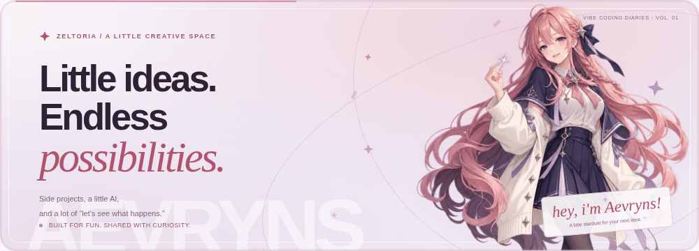
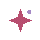
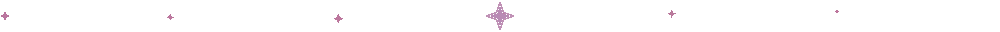

  <picture>
    <source media="(prefers-reduced-motion: reduce)" srcset="./assets/aevryns-banner.png">
    
  </picture>

<h1 align="center">Hey, I'm Zeltoria <picture><source media="(prefers-reduced-motion: reduce)" srcset="./assets/aevryns-mark.svg"></picture></h1>

  A curious person making small things, just because <em>“what if?”</em> sounds fun. 
  Little tools, playful websites, and experiments built through <strong>vibe coding</strong>.

  
  
  

  <picture>
    <source media="(prefers-reduced-motion: reduce)" srcset="./assets/stardust-divider.svg">
    
  </picture>

  <a href="https://github.com/Aevryns?tab=repositories">Explore my experiments</a>
  &nbsp;·&nbsp;
  <a href="https://github.com/Aevryns">@Aevryns</a>

### ✧ A little about this space

Most of my projects start as a random thought, a late-night idea, or something I wish existed. I build for fun, learn along the way, and share the experiments that grow into something useful.

**Vibe coding is part of the process.** I bring the idea and direction, use AI to help draft and debug, then test, review, and keep refining. Some things work. Some things become the next experiment. Both are part of learning.

### ✧ Currently making: Aevryns

My little digital laboratory — a place for creative tools, API experiments, and a rose-haired companion who makes the whole space feel a little warmer.

| A little corner | What I'm exploring |
| :--- | :--- |
| **Web experiments** | Clean interfaces, small interactions, and layouts that work on phones too. |
| **API playgrounds** | Trying endpoints, making examples, and turning useful bits into little tools. |
| **Anime-inspired design** | Rose pink, soft lavender, midnight navy, and a little stardust. |
| **AI-assisted building** | Going from “what if?” to a working idea, one small iteration at a time. |

### ✧ The things I reach for

`JavaScript` · `Node.js` · `HTML & CSS` · `REST APIs` · `Git & GitHub` · `AI coding tools`

No grand roadmap. Just curiosity, a few experiments, and the willingness to try again.

   
  <em>Built with curiosity, a little AI, and a lot of “let's see what happens.”</em> 
  Small ideas are welcome here. ♡

